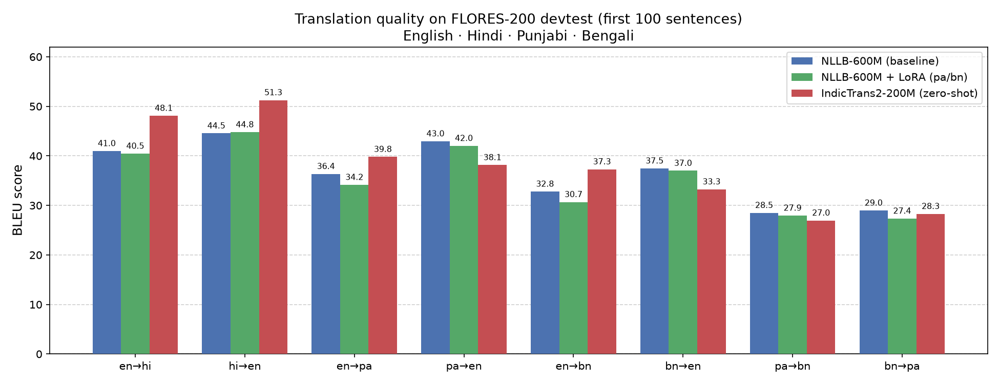
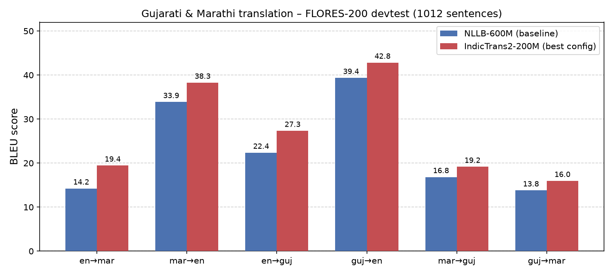
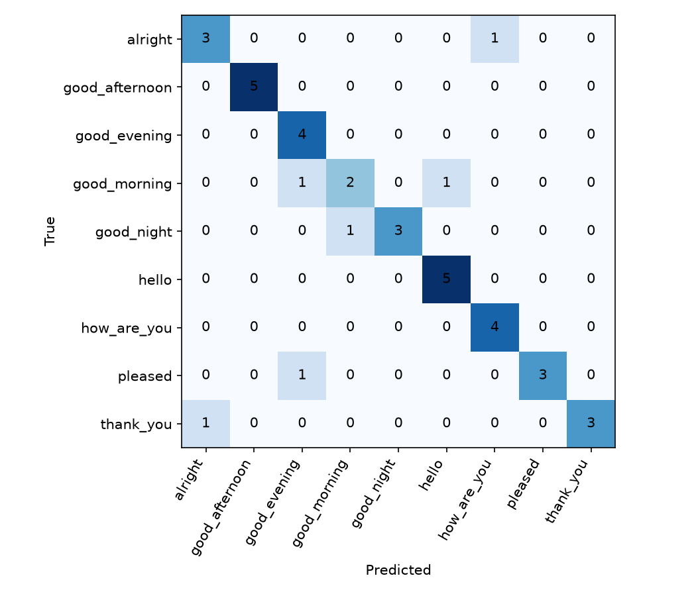
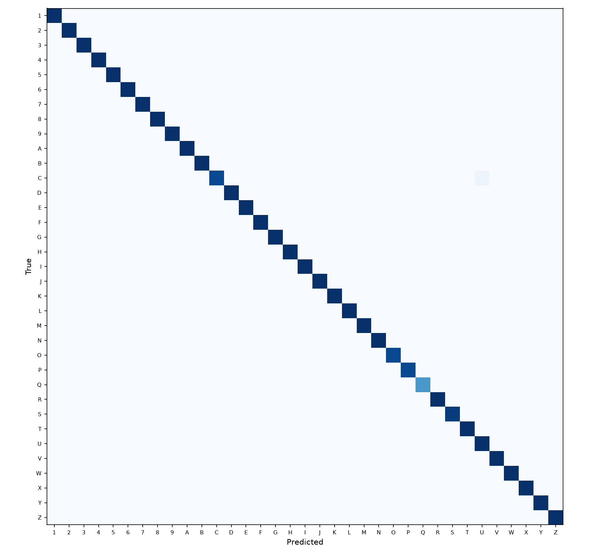

# TranslateEasy — Multilingual Communication Assistant

A Streamlit app combining **text/voice translation** across 6 Indian languages with **Indian Sign Language (ISL) recognition and generation** via MediaPipe.

---

## Features

| Tab | What it does |
|-----|-------------|
| **Translate** | Text or voice input → translated text + speech output (6 languages) |
| **Sign → Text** | Live camera recognises ISL gestures, fingerspelled letters, and word signs |
| **Text → Sign** | Converts English/Hindi text to ISL video clips + fingerspelling images |
| **Results** | BLEU/chrF++ scores and classifier confusion matrices |

**Supported languages:** English · Hindi · Punjabi · Bengali · Gujarati · Marathi

**Voice:** Sarvam AI Saaras v3 (STT) + Bulbul v3 (TTS)

---

## Architecture

```
app.py  (Streamlit UI)
│
├── translators/
│   ├── router.py              # routes each language pair to the right model
│   ├── translate_nllb.py      # NLLB-200 600M distilled (en/hi/pa/bn)
│   ├── translate_pa_bn.py     # IndicTrans2 200M distilled (en/hi/pa/bn)
│   └── translate_gu_mr.py     # IndicTrans2 200M + English pivot (gu/mr)
│
├── sign/
│   ├── live_camera.py         # real-time ISL recognition (gestures + letters + words)
│   ├── recognize.py           # word & letter inference helpers
│   ├── text_to_sign.py        # text → clip / fingerspell steps
│   ├── common.py              # BiLSTM model, feature extraction
│   ├── lexicon.py             # EN/HI display labels
│   ├── train_word_model.py    # BiLSTM training script
│   ├── train_alphabet_model.py# RandomForest training script
│   └── extract_keypoints.py  # MediaPipe keypoint extraction from raw videos
│
├── voice/
│   └── sarvam_voice.py        # STT + TTS via Sarvam AI SDK
│
└── evaluation/
    ├── eval_nllb_flores.py
    ├── eval_indictrans2_flores.py
    ├── eval_lora_flores.py
    └── eval_pivot_flores.py
```

---

## Translation Results

Evaluated on **FLORES-200 devtest** (sacrebleu BLEU + chrF++, beam size 4–5).

### English · Hindi · Punjabi · Bengali — first 100 sentences



| Direction | NLLB-600M | NLLB + LoRA | IndicTrans2-200M |
|-----------|:---------:|:-----------:|:----------------:|
| en → hi   | 41.0 / 58.5 | 40.5 / 57.8 | **48.1 / 63.8** |
| hi → en   | 44.6 / 65.3 | 44.8 / 64.9 | **51.3 / 69.5** |
| en → pa   | 36.4 / 48.4 | 34.2 / 46.8 | **39.8 / 52.8** |
| pa → en   | **43.0** / **63.1** | 42.0 / 62.3 | 38.2 / 63.7 |
| en → bn   | 32.8 / 47.0 | 30.7 / 45.3 | **37.3 / 49.7** |
| bn → en   | **37.5** / **58.4** | 37.0 / 57.9 | 33.3 / 58.5 |
| pa → bn   | **28.5** / **42.6** | 27.9 / 41.5 | 27.0 / 42.6 |
| bn → pa   | **29.0** / **41.8** | 27.4 / 40.5 | 28.3 / 43.1 |

*BLEU / chrF++. Bold = best per direction.*

**Key finding:** IndicTrans2 zero-shot leads on English↔Hindi and English→Bengali/Punjabi. NLLB holds its own on Punjabi/Bengali→English and cross-script pairs (pa↔bn). The LoRA fine-tune on pa/bn did not beat the NLLB baseline.

---

### Gujarati & Marathi — full 1012 sentences



| Direction | NLLB-600M | IT2 zero-shot (best) |
|-----------|:---------:|:--------------------:|
| en → mar  | 14.2 / 44.8 | **19.4 / 50.7** |
| mar → en  | 33.9 / 58.9 | **38.3 / 62.5** |
| en → guj  | 22.4 / 50.3 | **27.3 / 55.6** |
| guj → en  | 39.4 / 62.6 | **42.8 / 65.4** |
| mar → guj | 16.8 / 44.7 | **19.2 / 47.1** *(English pivot)* |
| guj → mar | 13.8 / 42.9 | **16.0 / 45.8** *(English pivot)* |

IndicTrans2 zero-shot beats NLLB on every Gujarati/Marathi direction. For mar↔guj, English pivot outperforms both direct and Hindi pivot.

---

## Sign Language

### Word recognition — BiLSTM on MediaPipe holistic keypoints

- **9 ISL words** from the INCLUDE-50 dataset (hello, how are you, alright, good morning/afternoon/evening/night, thank you, pleased)
- **Test accuracy: 84.2%** on a held-out 20% split



### Alphabet recognition — Random Forest on hand landmarks

- **35 classes** (A–Z + digits 1–9), trained on the Indian Sign Language alphabet dataset
- **Test accuracy: 99.9%** (inflated — near-duplicate images across train/test)



### Live camera controls

| Key | Action |
|-----|--------|
| `SPACE` | Add current gesture / letter, or start/stop word recording |
| `A` | Force-add current letter |
| `M` | Switch mode (Gestures+Alphabet ↔ Words) |
| `L` | Toggle English / Hindi output |
| `BACKSPACE` | Delete last item |
| `C` | Clear all |
| `Q` | Quit camera |

---

## Setup

### Prerequisites

- Python 3.11 or 3.12
- macOS (tested on Apple M-series); Linux should work without the `open -a Terminal` camera launch

### Install

```bash
git clone https://github.com/Kumkum33517/TranslateEasy.git
cd TranslateEasy
python -m venv .venv
source .venv/bin/activate

pip install torch transformers==4.46.3 "datasets<4" peft accelerate \
    sacrebleu sentencepiece pandas tqdm streamlit sarvamai \
    mediapipe opencv-python pillow joblib scikit-learn
pip install git+https://github.com/VarunGumma/IndicTransToolkit.git
```

### Missing model files (not in Git — too large)

The two trained sign-language models must be added back manually:

| File | How to get it |
|------|--------------|
| `models/word_model.pt` | Run `python sign/train_word_model.py` after adding keypoint data |
| `models/alphabet_model.joblib` | Run `python sign/train_alphabet_model.py` after adding image data |

The sign-clip videos (`data/sign_clips/`) are also excluded (124 MB total). Place your `.MOV`/`.mp4` files there for the Text → Sign tab to work.

### Environment variables

```bash
export SARVAM_API_KEY=your_key_here   # required for voice input/output
```

Get a key at [sarvam.ai](https://sarvam.ai). Translation and sign features work without it.

### Run

```bash
streamlit run app.py
```

Open http://localhost:8501 in your browser.

---

## Notes

- `transformers==4.46.3` is required — IndicTrans2's remote tokenizer code is version-sensitive.
- `peft` is only imported when `USE_LORA = True` in `translate_gu_mr.py` (off by default; LoRA did not beat zero-shot in our evaluation).
- On a 16 GB Mac, load only one translation model at a time to avoid MPS swap slowdowns.
- The Hugging Face IndicTrans2 repos are gated — run `huggingface-cli login` and accept terms before first use.
